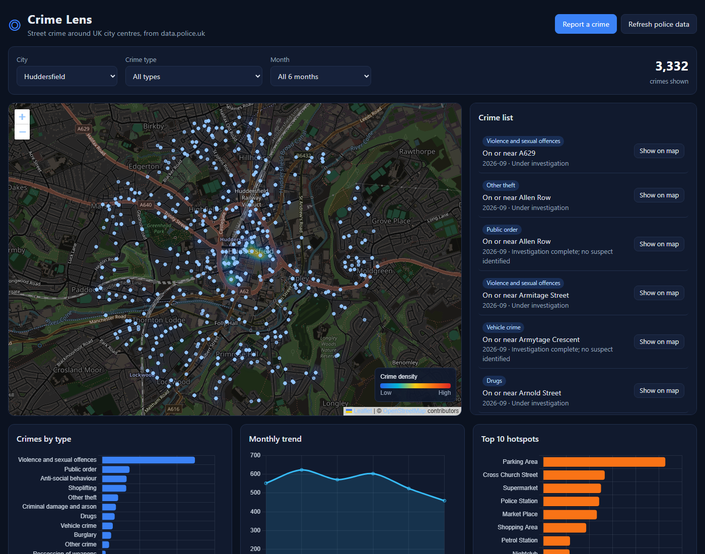

# Crime Lens

[](https://github.com/muntaka-mahdin/crime-lens/actions/workflows/pages.yml)

An interactive street crime map and analytics dashboard for UK city centres, built on open data from [data.police.uk](https://data.police.uk).

**Live demo: [muntaka-mahdin.github.io/crime-lens](https://muntaka-mahdin.github.io/crime-lens/)**

Pick a city and Crime Lens shows the last six months of reported street crime on a map, with a heatmap of where it's concentrated, a filterable list, and charts for crime types, monthly trends and the top hotspots. You can also add your own report, which is geocoded from a typed address and shown on the map.



> **About this version.** Crime Lens was my final year project for my BSc Computer Science at the University of Huddersfield (2025), originally built with Laravel, MySQL, Bootstrap, Leaflet.js and Chart.js. The original code was lost along with my old university GitHub account, so in November 2026 I rebuilt it from my project report in TypeScript and Next.js, so that it can run as a live demo. The features and design follow the report; the changes are listed below.

## Features

- **Live police data**: street-level crimes within a mile of each city centre, for the latest six months published by data.police.uk (Huddersfield, Leeds, Sheffield, Birmingham and Westminster).
- **Heatmap and markers**: crime density from blue (low) to red (high), with a marker and popup for each crime.
- **Filters**: by crime type and by month. The map, the list and the charts all update together.
- **Crime list**: newest first, with a "Show on map" button that flies to the crime and highlights it.
- **Charts**: crimes by type, monthly trend, and the top 10 hotspot streets.
- **Report a crime**: type, location, month and an optional description. The address is turned into coordinates with OpenStreetMap's Nominatim. Reports are saved in your browser only.

## How it works

The whole app runs in the browser and is built to static files, so it can be hosted anywhere (it's on GitHub Pages, deployed by a GitHub Actions workflow on every push to `main`). Both data sources allow browser requests, so no backend or API keys are needed.

```
Browser (React)                                                            Open data
──────────────────                                                         ─────────────────
Dashboard  ── latest 6 months, one month at a time, retry when busy ──▶   data.police.uk
  map / list / charts      deduped, packed and cached in the browser for 12 hours
  (filters run client-side)
ReportForm ── UK-only address lookup ─────────────────────────────────▶   OpenStreetMap Nominatim
```

- `lib/police.ts` fetches and normalises police records, with retries because the API rate-limits.
- `lib/data.ts` loads a city's last six months and caches it in `localStorage`.
- `lib/geocode.ts` turns a typed address into coordinates.
- `lib/dedupe.ts` removes duplicate records.
- `lib/compact.ts` packs crimes into lookup tables, so London (about 26,000 crimes) is cached in around 1 MB instead of about 3 MB.
- `lib/stats.ts` holds the counting and filtering behind the charts and list.
- `components/` has the dashboard, the Leaflet map (react-leaflet with leaflet.heat), the list, the charts (Chart.js) and the report form.

## What changed from the original

| Original (2025) | This rebuild (2026) | Why |
|---|---|---|
| Laravel 12, PHP 8, Blade views | Next.js, React, TypeScript | Runs as a free live demo, and matches the stack I work in now |
| Laravel server and MySQL, filled by an "import" button | Static site; the browser fetches live from the API and caches for 12 hours | Free to host anywhere, nothing to run; data stays current |
| Duplicates matched on type, location, coordinates and month | Matched on the police record id | Police data snaps crimes to anonymous points, so different crimes on the same street in the same month can share all four values |
| OpenCage geocoding (API key) | OpenStreetMap Nominatim (no key) | Free, with no secrets to manage |
| Manual reports saved to MySQL | Saved in the browser (localStorage) | A public demo shouldn't let anyone write to a shared database |
| Manchester and Huddersfield | Huddersfield, Leeds, Sheffield, Birmingham, Westminster | Greater Manchester Police don't currently publish street-level crime to data.police.uk |
| Manual testing only | Unit tests with Vitest for deduplication, stats, packing and parsing | Catches regressions |

## Run it locally

You need Node.js 20 or newer.

```bash
npm install
npm run dev      # http://localhost:3000
npm test         # unit tests
npm run build    # static site in ./out
```

No API keys are needed.

## Data and licences

- Crime data: [data.police.uk](https://data.police.uk), Open Government Licence v3.0. Locations are approximate on purpose: each crime is snapped to a nearby anonymous point.
- Map tiles and geocoding: © [OpenStreetMap](https://www.openstreetmap.org/copyright) contributors.
- Code: MIT licence.

## Author

**Muntaka Mahdin** · [GitHub](https://github.com/muntaka-mahdin) · [LinkedIn](https://www.linkedin.com/in/muntaka-mahdin-2a80b8233/)

More of my projects: [Hotel cancellation prediction](https://github.com/muntaka-mahdin/hotel-cancellation-prediction) · [Pet Activity Tracker](https://github.com/muntaka-mahdin/pet-activity-tracker) · [Card-G](https://github.com/muntaka-mahdin/card-g) · [Hand-washing step recognition](https://github.com/muntaka-mahdin/hand-washing-steps)
